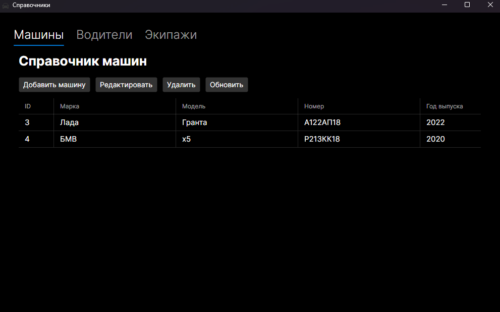
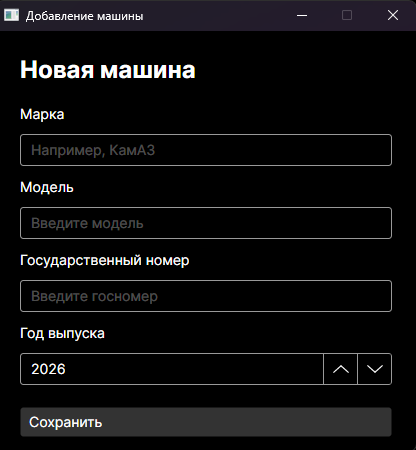
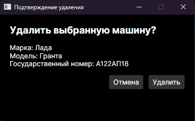
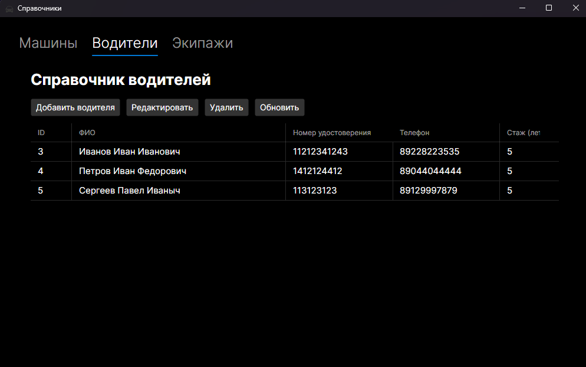
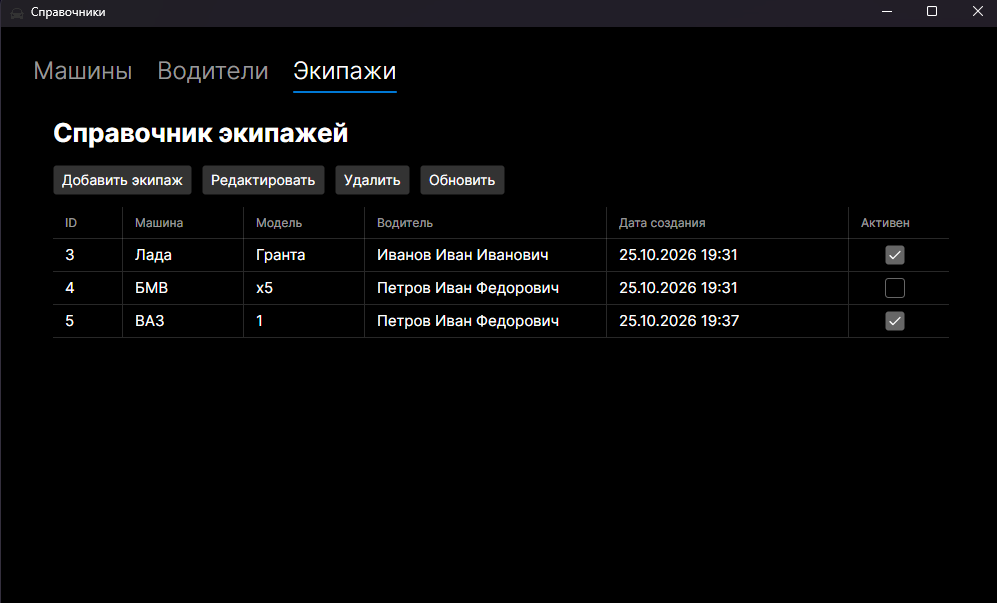

## Технологии

### - C#
### - .NET 10
### - Avalonia UI
### - PostgreSQL
### - Entity Framework Core


## 1. Клонирование репозитория

Откройте терминал и выполните команды:

```bash
git clone https://github.com/pivzor/CatalogApp.git
cd CatalogApp
```

Восстановите зависимости проекта:

```bash
dotnet restore
```

## 2. Импорт готовой базы данных

В репозитории находится готовый файл базы данных `db.sql`.

### Шаг 1. Создайте базу данных

Откройте PostgreSQL через pgAdmin.

1. Найдите раздел **Databases**.
2. Нажмите правой кнопкой мыши и выберите **Create → Database**.
3. Укажите имя базы данных: `db`.
4. Сохраните изменения.

### Шаг 2. Импортируйте SQL-файл

1. Выберите созданную базу данных `db`.
2. Откройте инструмент **Query Tool**.
3. Откройте файл `db.sql` из скачанного проекта.
4. Скопируйте содержимое файла в Query Tool.
5. Нажмите **Execute** для выполнения SQL-команд.

После успешного выполнения таблицы будут созданы в базе данных.

> Если импорт завершился ошибкой, проверьте, что выбрана правильная база данных и что SQL-файл соответствует используемой версии проекта.

## 3. Применение миграций Entity Framework Core

Если импортировать `db.sql` не получилось, можно создать структуру базы данных с помощью миграций Entity Framework Core.

В проекте уже предусмотрены миграции, поэтому сначала попробуйте применить существующие миграции.

### 3.1. Применение существующих миграций

1. Откройте решение `CatalogApp` в Visual Studio.
2. Перейдите в меню **Вид → Другие окна → Консоль диспетчера пакетов**.
3. В поле **Проект по умолчанию** выберите `Catalog.DAL`.
4. Выполните команду:

```
update-database
```

Команда применит существующие миграции к базе данных.

### 3.2. Создание новой миграции

Если структура моделей изменилась и необходимо создать новую миграцию:

1. Откройте консоль диспетчера пакетов.
2. В поле **Проект по умолчанию** выберите `Catalog.DAL`.
3. Выполните команду, указав название миграции:

```
add-migration "НазваниеМиграции"
```

После создания миграции примените изменения к базе данных:

```
update-database
```

### 3.3. Удаление последней миграции

Если последняя миграция создана, но ещё не применена к базе данных, её можно удалить командой:

```
update-database
```

При необходисти отката миграции:

```
update-database 0
```

Затем удалите последнюю миграцию:

```
remove-migration
```

## 4. Настройка подключения к PostgreSQL

Перед запуском приложения необходимо указать пароль от PostgreSQL.

Откройте следующие файлы:

- `CatalogApp/App.axaml.cs`
- `Catalog.DAL/AppDbContextFactory.cs`

В каждом файле найдите строку подключения, похожую на эту:

```
"Host=localhost;Port=5432;Database=db;Username=postgres;Password=12345678"
```

Замените `12345678` на собственный пароль пользователя PostgreSQL.

Проверьте следующие параметры:

- `Host=localhost` — PostgreSQL установлен на этом компьютере.
- `Port=5432` — порт PostgreSQL.
- `Database=db` — имя базы данных.
- `Username=postgres` — имя пользователя PostgreSQL.
- `Password=...` — ваш пароль.

Если вы используете другие имя пользователя, порт или название базы, замените соответствующие значения в обоих файлах.

## 5. Сборка и запуск приложения

Откройте терминал в папке решения и выполните:

```
dotnet restore
dotnet build -c Release
```

После успешной сборки запустите приложение:

```
dotnet run --project CatalogApp
```

## 6. Скриншоты приложения
### Справочник авто


### Добавление авто


### Удаление авто


### Справочник Водителей


### Справочник Экипажа


